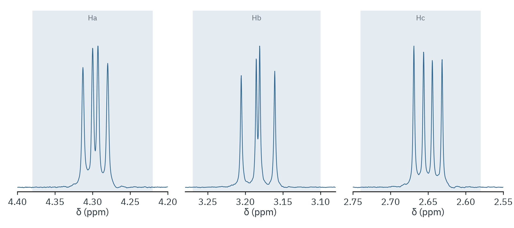

[](https://github.com/dhwan0112/nmr-tool/actions/workflows/tests.yml)

# nmr-tool

A command-line shell and a small Python package for looking at processed
Bruker ¹H NMR spectra: referencing, baseline, line positions, coupling
constants, integrals, mass correction for residual solvent, and figures.

It reads the processed spectrum (`pdata/1/1r`) directly. It does not need
TopSpin or MestReNova, and it does not redo the Fourier transform or phasing.

## What it does

- Reads a Bruker experiment folder or a `.zip` of one.
- References the axis to a known signal (default: residual CHCl₃ at δ 7.26)
  and flattens the baseline.
- Picks line positions and reports first-order coupling constants.
- Builds an integral table and converts it to mole ratios, weight fractions
  and masses (mass correction for any number of components).
- Writes figures as PNG, SVG or PDF files: one panel per ppm range, or
  spectra stacked one above the other with magnified insets.

## Install

```bash
python -m venv .venv && source .venv/bin/activate
pip install -e .
```

This installs the `nmrtools` command. Without installing, use
`pip install -r requirements.txt` and `python -m nmrtools` from the
repository root.

## Interactive shell

```text
$ nmrtools path/to/experiment.zip
nmr> ref
nmr> baseline offset
nmr> j 5.86 5.96
nmr> integrate 5.80 6.00 name=product nh=1 mw=154.25
nmr> integrate 4.05 4.20 name=EtOAc nh=2 mw=88.11
nmr> mass 0.4725 target=product
nmr> label 5.91 Ha
nmr> plot 4.9 6.1 1.1 2.3 out=product.svg
nmr> help
```

`help` lists every command and `help <command>` shows its usage. Figures are
written as image files; nothing is drawn in the terminal.

`plot` draws one panel per ppm range, each scaled to its tallest peak, with
the `label` texts above their peaks and the integral windows shaded. `stack`
compares spectra one above the other and can add magnified insets:

```text
$ nmrtools crude.zip purified.zip
nmr> stack 0.45 6.2 zoom=3.6:4.3 x=10 out=compare.png
```

`load` applies no corrections; use `ref` and `baseline` yourself. `prepare`
runs `ref`, `baseline offset` and `baseline poly` with their default regions,
which were chosen for the example spectra, so check them for another compound.
`preset <file.json>` fills the integral table from a file (see
[examples/cm3191/organic-4-linalool/expt4.json](examples/cm3191/expt4.json)).

Commands can also be run without the prompt,
`nmrtools experiment.zip -c "ref; j 5.86 5.96"`, or piped in on standard
input (`nmrtools < session.nmr`); lines that start with `#` are comments.
With `-c` the exit code is 1 if any command failed.

## Python package

```python
from nmrtools import load_spectrum, pick_lines, coupling_constants, integrate

spec = load_spectrum("experiment.zip").referenced().baseline_offset()
centre, js = coupling_constants(pick_lines(spec, 5.86, 5.96, n=4), spec.sf)
area = integrate(spec, 5.80, 6.00)
```

## Examples

[examples/cm3191](examples/cm3191) holds six worked examples from an
undergraduate synthesis lab course, each with its figure and the commands
that made it: stacked spectra on an internal standard, ¹³C satellites,
an aromatic region with integral windows, a three-spin system with its
coupling constants, a diastereomer ratio, and a complete analysis script
(yield and mass correction for (±)-linalool).



## Limits

- Only processed 1D spectra are read. There is no Fourier transform,
  phasing or apodisation.
- Integrals are plain sums over the windows. Routine spectra (short
  relaxation delay) are not quantitative; treat mole ratios as ±10%.
- Coupling constants are first-order, from the line positions of a doublet
  or a doublet of doublets.
- The results have not been cross-checked against MestReNova.

## Tests

```bash
pip install -e ".[test]"
pytest
```

The tests use synthetic spectra, so they run without spectrometer data.

## Layout

```
nmrtools/bruker.py     read pdata/1/1r, referencing, baseline
nmrtools/analysis.py   lines, coupling constants, integrals, mass correction
nmrtools/plots.py      panel and stack figures
nmrtools/cli.py        interactive shell (`nmrtools`, `python -m nmrtools`)
examples/cm3191/       worked examples with figures, one folder per experiment
tests/                 synthetic-data tests
```

## License

MIT. See [LICENSE](LICENSE).
