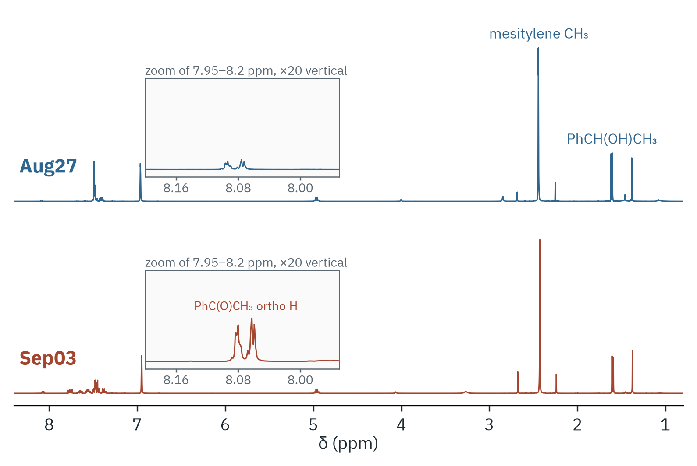
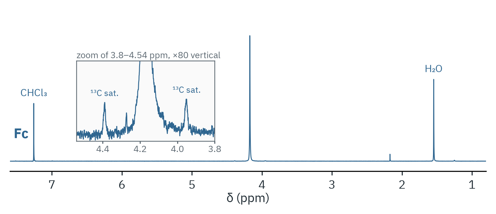
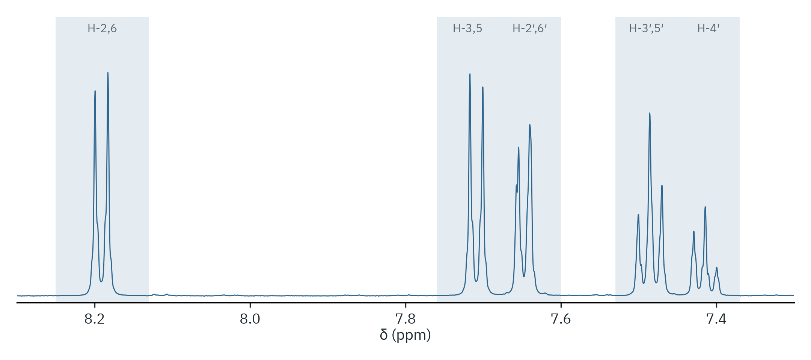
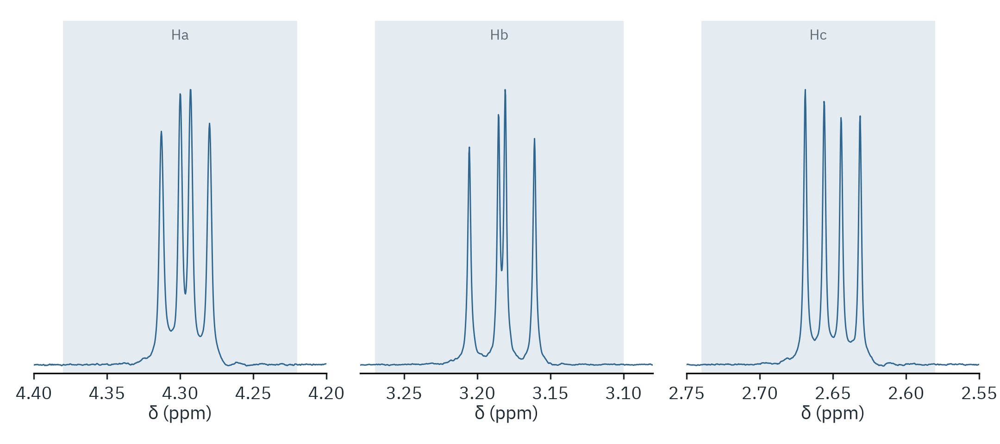
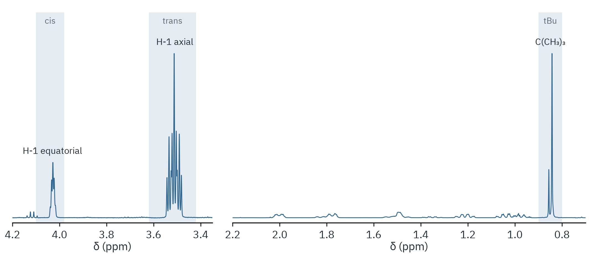
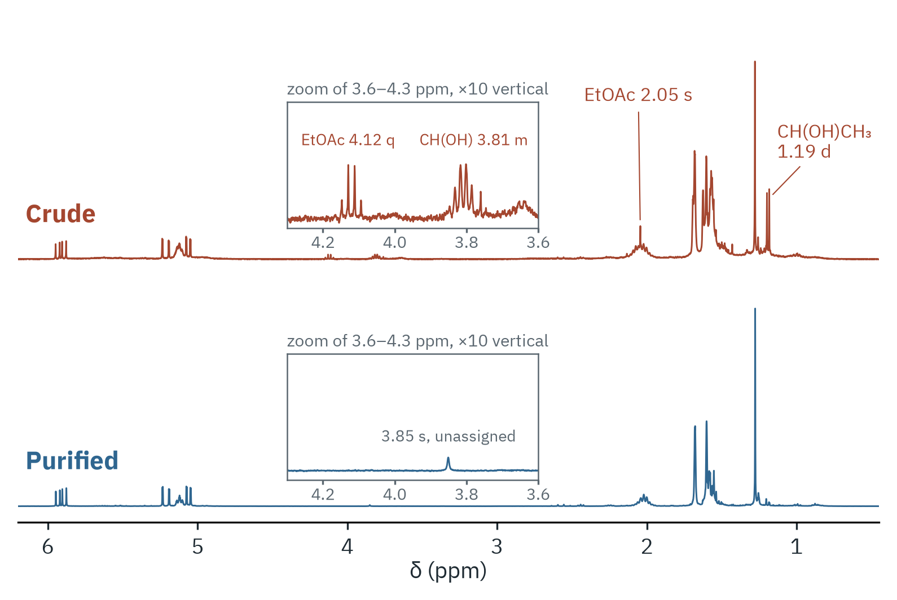

# Examples: CM3191 teaching-lab spectra

Six ¹H NMR data sets from an undergraduate synthesis lab course (NUS CM3191,
AY26/27), each worked through with `nmrtools`. All were recorded in CDCl₃
with the standard `zg30` experiment (8 scans) at 400 or 500 MHz.

Every folder holds the figure, a short note on what was measured, and the
commands that produced both. The raw spectrometer exports are not in this
repository.

| Folder | Experiment | What the example shows |
|---|---|---|
| [inorganic-1-transfer-hydrogenation](inorganic-1-transfer-hydrogenation) | Ru-catalysed oxidation of 1-phenylethanol | two spectra stacked on an internal standard, magnified inset |
| [inorganic-2-ferrocene](inorganic-2-ferrocene) | ferrocene | ¹³C satellites of a singlet at 80-fold gain |
| [organic-1-suzuki](organic-1-suzuki) | 4-biphenylcarboxylic acid by Suzuki coupling | aromatic region with integral windows |
| [organic-2-aldol-diels-alder](organic-2-aldol-diels-alder) | one-pot aldol condensation and Diels–Alder reaction | three doublets of doublets and their coupling constants |
| [organic-3-borohydride-reduction](organic-3-borohydride-reduction) | NaBH₄ reduction of 4-*tert*-butylcyclohexanone | diastereomer ratio from two integrals |
| [organic-4-linalool](organic-4-linalool) | (±)-linalool by a Grignard reaction | a complete analysis script: yield, mass correction, custom figures |

## Running a command file

The first five examples are plain command files for the shell. Lines that
start with `#` are comments. Put the export named in the file's `load` line
in `data/` (ignored by git) and run from the repository root:

```bash
nmrtools < examples/cm3191/organic-2-aldol-diels-alder/session.nmr
```

## Gallery

| | |
|---|---|
|  |  |
|  |  |
|  |  |
