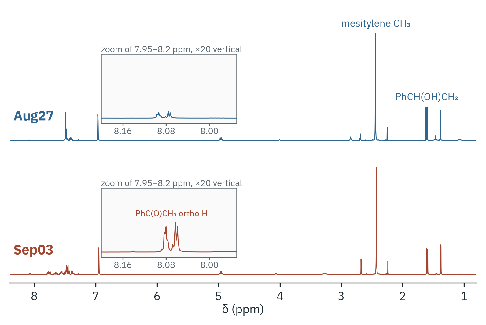

# Ru-catalysed oxidation of 1-phenylethanol

Two reaction samples taken a week apart (27 Aug and 3 Sep), 400 MHz, CDCl₃.
1-Phenylethanol is oxidised to acetophenone in acetone with a ruthenium
catalyst; mesitylene is the internal standard.



Each trace is scaled to the mesitylene CH₃ singlet, so heights compare
directly between the two samples. The inset magnifies the acetophenone
*ortho* protons 20-fold.

| Signal | Window (ppm) | nH | 27 Aug | 3 Sep |
|---|---|---|---|---|
| mesitylene CH₃ | centre ± 0.06 | 9 | 1.000 | 1.000 |
| acetophenone *ortho* H | 8.035–8.120 | 2 | 0.020 | 0.095 |
| 1-phenylethanol CH(OH) | 4.88–5.04 | 1 | 0.735 | 0.707 |

The numbers are moles relative to mesitylene (integral ÷ nH). Both samples
still hold mostly starting alcohol. The acetophenone CH₃ singlet near
2.68 ppm overlaps other signals and is not used.

Shifts are left as recorded. The samples contain much of the reaction
solvent, every signal sits about 0.1 ppm downfield of its value in neat
CDCl₃, and no line is a safe reference.

```bash
nmrtools < examples/cm3191/inorganic-1-transfer-hydrogenation/session.nmr
```
