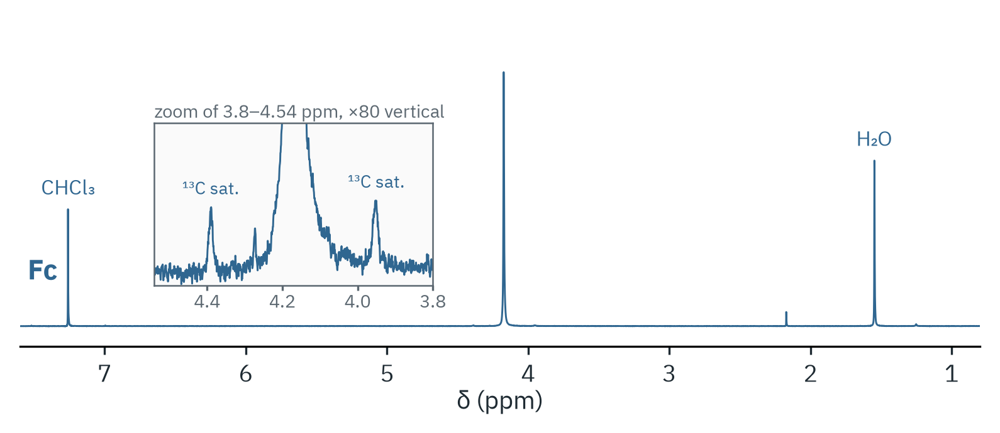

# Ferrocene

Purified ferrocene, 400 MHz, CDCl₃.



The ten ring protons give one singlet at δ 4.17. The inset shows the same
region at 80-fold gain: the ¹³C satellites sit at δ 4.389 and 3.953, which
is ¹J(C,H) = 175 Hz. The other lines are residual CHCl₃ (7.26), water (1.55)
and a trace of acetone (2.17).

| Signal | Window (ppm) | nH | Moles relative to ferrocene |
|---|---|---|---|
| Cp–H | 4.05–4.30 | 10 | 1.00 |
| H₂O | 1.45–1.65 | 2 | 1.87 |

```bash
nmrtools < examples/cm3191/inorganic-2-ferrocene/session.nmr
```
