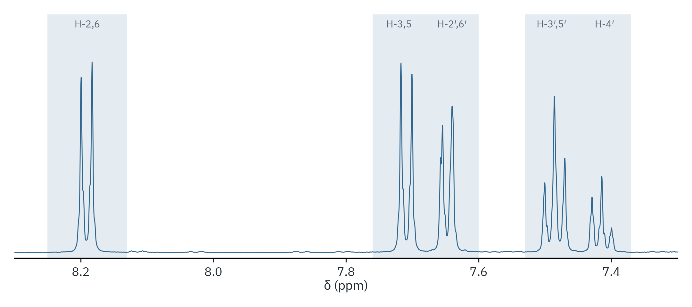

# 4-Biphenylcarboxylic acid (Suzuki coupling)

Product of 4-bromobenzoic acid and phenylboronic acid, 500 MHz, CDCl₃.



| Signal | δ (ppm) | Window (ppm) | nH | Integral ÷ nH |
|---|---|---|---|---|
| H-2,6 | 8.19, d, J = 8.3 Hz | 8.13–8.25 | 2 | 1.00 |
| H-3,5 | 7.71, d | 7.68–7.76 | 2 | 1.01 |
| H-2′,6′ | 7.65, m | 7.60–7.68 | 2 | 1.04 |
| H-3′,5′ | 7.49, m | 7.45–7.53 | 2 | 1.02 |
| H-4′ | 7.41, m | 7.37–7.45 | 1 | 1.00 |

The aromatic lines crowd the default reference search window (7.20–7.35),
so `ref 7.26 7.275 7.295` picks out the residual CHCl₃ line with a narrower
one.

```bash
nmrtools < examples/cm3191/organic-1-suzuki/session.nmr
```
