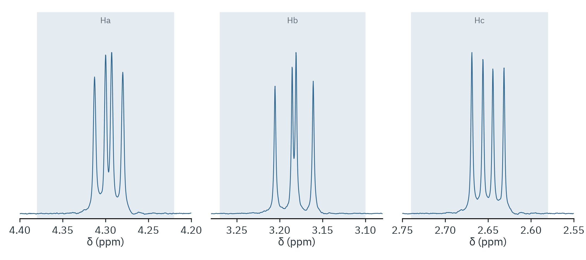

# One-pot aldol condensation and Diels–Alder reaction

Cycloadduct with styrene, 500 MHz, CDCl₃. The benzylic CH (Ha) and the two
protons of the neighbouring CH₂ (Hb, Hc) form a first-order three-spin
system.



| Proton | δ (ppm) | Multiplicity | J (Hz) | Integral |
|---|---|---|---|---|
| Ha | 4.30 | dd | 10.0, 6.5 | 1.000 |
| Hb | 3.18 | dd | 12.3, 10.0 | 1.000 |
| Hc | 2.65 | dd | 12.3, 6.5 | 0.997 |

The three couplings agree pairwise: 12.3 Hz is the geminal coupling
between Hb and Hc, 10.0 and 6.5 Hz are the vicinal couplings to Ha.
Residual ethyl acetate is 1.4 mol% of the adduct (singlet at 2.05, 3 H).

The aromatic multiplet covers residual CHCl₃, so the axis is referenced to
the ethyl acetate singlet instead: `ref 2.05 2.00 2.15`.

```bash
nmrtools < examples/cm3191/organic-2-aldol-diels-alder/session.nmr
```
