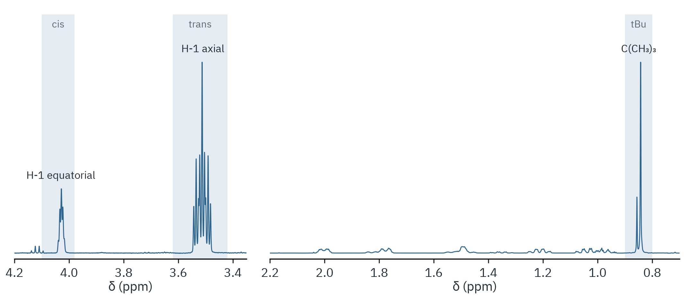

# NaBH₄ reduction of 4-*tert*-butylcyclohexanone

Mixture of *trans*- and *cis*-4-*tert*-butylcyclohexanol, 500 MHz, CDCl₃.



The carbinol proton H-1 is axial in the *trans* alcohol (δ 3.51, wide
multiplet with two large axial–axial couplings) and equatorial in the *cis*
alcohol (δ 4.03, narrow multiplet). Their integrals give the diastereomer
ratio directly.

| Signal | Window (ppm) | nH | Integral |
|---|---|---|---|
| *trans*, H-1 axial | 3.42–3.62 | 1 | 1.000 |
| *cis*, H-1 equatorial | 3.98–4.10 | 1 | 0.261 |
| C(CH₃)₃, both isomers | 0.80–0.90 | 9 | 11.78 |

*trans* : *cis* = 3.8 : 1 (79 : 21). The *tert*-butyl integral is 9.3 H per
alcohol molecule, close to the expected 9. The small quartet at 4.12 is
residual ethyl acetate and lies outside the *cis* window.

```bash
nmrtools < examples/cm3191/organic-3-borohydride-reduction/session.nmr
```
