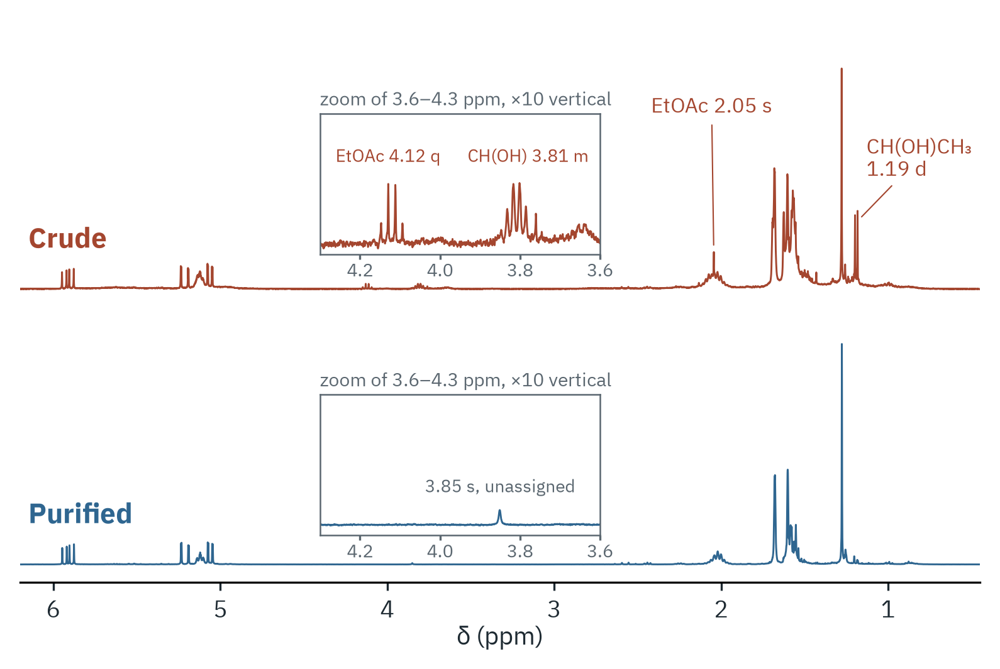
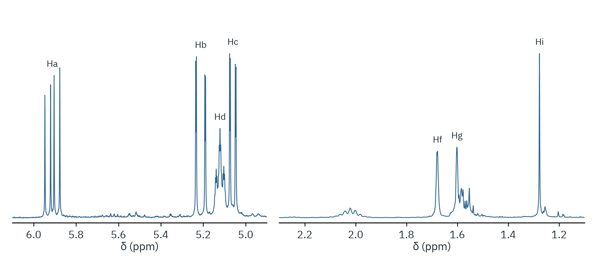

# (±)-Linalool by a Grignard reaction (CM3191 Organic Experiment 4)

This example reproduces the ¹H NMR numbers and figures used for CM3191
Organic Experiment 4, the Grignard synthesis of (±)-linalool (NUS, AY26/27),
from the crude and the column-purified spectrum.





| File | Purpose |
|---|---|
| `run_expt4.py` | the whole analysis: prints a summary, writes `results.json` and two figures |
| `figures.py` | the two figures, with the labels of this experiment |
| `expt4.json` | integration windows and molar masses; also a shell preset |

## Run

Raw data are not in this repository. Put the two spectrometer exports in
`data/` (ignored by git), then from the repository root:

```bash
python examples/cm3191/organic-4-linalool/run_expt4.py \
    --crude    data/CM3191-Week_11-Thurs-400-Oct29-2026-C05.zip \
    --purified data/CM3191-Week_11-Thurs-400-Oct29-2026-P05.zip \
    --out results
```

This prints a summary and writes `results/results.json`,
`results/nmr_purified.png` and `results/nmr_crude_vs_purified.png`.
Masses and the ketone volume default to the values on the signed datasheet
and can be changed with `--crude-mass`, `--purified-mass` and `--ketone-ml`.

Expected summary:

| Quantity | Value |
|---|---|
| Ketone | 2.98 mmol (0.44 mL × 0.855 g mL⁻¹ ÷ 126.20 g mol⁻¹) |
| Theoretical linalool | 0.460 g |
| Purified yield | 33.7% (0.1549 g) |
| Crude mole ratio, linalool : side product : EtOAc | 1 : 0.57 : 0.08 |
| Linalool in crude | ≈ 66 wt%, 0.311 g |
| Column recovery (linalool basis) | ≈ 50% |

The same numbers in the shell:

```text
$ nmrtools data/crude.zip
nmr> prepare
nmr> j 5.86 5.96
nmr> preset examples/cm3191/organic-4-linalool/expt4.json
nmr> mass 0.4725 target=linalool
```

## Method

The axis is referenced to residual CHCl₃ at δ 7.26. The baseline is a
quadratic fitted through signal-free regions, and integrals are plain sums
over the windows. Mole ratios use one well-resolved, non-overlapping
resonance per species, divided by its number of protons:

| Species | Signal | Window (ppm) | nH |
|---|---|---|---|
| Linalool | CH=CH₂ internal H, δ 5.91 | 5.80–6.00 | 1 |
| Side product | CH(OH), δ 3.81 | 3.70–3.92 | 1 |
| Ethyl acetate | OCH₂, δ 4.12 | 4.05–4.20 | 2 |

The mass correction follows the course handout *Correcting Compound Mass and
Yield for Residual Solvent Using ¹H NMR*, extended from two to three
components.

## Limits

- The spectra were acquired with `zg30`, D1 = 1 s and 8 scans. That is not a
  quantitative experiment, so treat the mole ratios as ±10%.
- Only the three listed species are counted. Water, salts or grease are not,
  so the linalool weight fraction is an upper bound.
- The side product is assigned tentatively as 6-methyl-5-hepten-2-ol.
- The integration windows and baseline regions are set for these spectra.

The course submission itself (the lab report and datasheets) is not included
in this repository.
